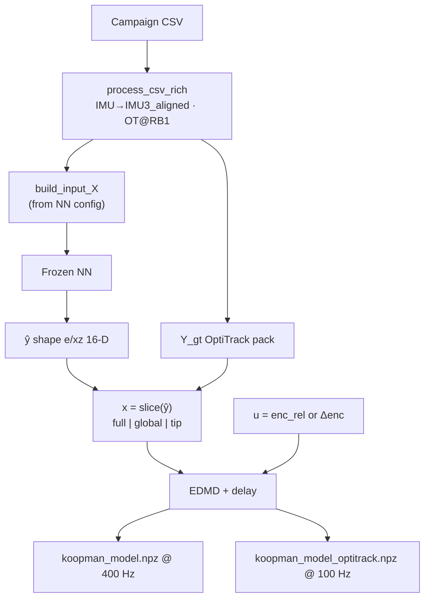

# Koopman training (one-seg continuum)

Linear Koopman operators for the one-segment continuum robot. Two models are fit from the same packed shape state:


| Model                 | State source                          | Rate                    | File                          |
| --------------------- | ------------------------------------- | ----------------------- | ----------------------------- |
| **NN Koopman**        | Frozen NN reconstructed shape ŷ       | **400 Hz** (native CSV) | `koopman_model.npz`           |
| **OptiTrack Koopman** | Ground-truth packed OptiTrack shape Y | **100 Hz**              | `koopman_model_optitrack.npz` |


The NN path is the one used for **closed-loop ramping / MPC**. The OptiTrack path is a **reference / upper bound**.

Switching `nn_model_rel` (LSTM vs MLP) automatically changes the **sensor → NN INPUT** pack from that run’s `config.json`. Both locked NNs share the same **OUTPUT** (16-D `e`/`xz`) used as Koopman state `x`.

---

## Directory layout

```
Koopman training/
├── README.md
├── src/
│   ├── Koopman_training_embedding_shape.py   ← main training
│   └── Koopman_validation_embedding_shape.py ← data-size study
└── Model/
    └── <NN_arch>/<nn_run_id>/
        └── koop_d<delay>_seed<seed>_<x_mode>_<ident>[_hz100]/
            ├── koopman_model.npz
            ├── koopman_model_optitrack.npz
            ├── results.json
            └── fig_*.png
```

NN checkpoints:

```
IMU_oneseg_ws/NN_training/Training/models/<arch>/<run_id>/
  config.json   model.pt
```

---

## Prerequisites

1. Trained NN with `config.json` + `model.pt` (locked LSTM and/or MLP below).
2. Campaign CSV under `IMU_oneseg_ws/` (e.g. `data_20260821_191427.csv`).
3. Shared venv:

```bash
source "/root/DataCollection/IMU_oneseg_ws/NN_training/.venv/bin/activate"
```

---

## Sensor → NN → Koopman (data contract)

Same rich pipeline as NN training (`common.data_pipeline.process_csv_rich`):

```text
CSV sensors
  ├─ IMU_raw  → R_imu_in_rb (RB-align) → under IMU3_aligned   (IMU3 ≡ I)
  │              mount: first ~5 s (n_imu_calib=2000) or WS R_imu_in_rb.npz
  ├─ OT_raw   → under RB1   (shape labels Y)
  └─ enc      → home-relative (real_enc − home)

build_input_X(… flags from NN config.json …)  →  X  (NN INPUT)
frozen NN(X)                                  →  ŷ  (NN OUTPUT)
slice ŷ (koopman_x_mode)                      →  x  (Koopman state)
enc_rel / Δenc                                →  u  (Koopman control)
```

Physical map: **IMU1→RB5 tip**, **IMU2→RB3 mid**, **IMU3→RB1 base**.  
NN feature `**imu12`**: tip+mid quats only (IMU3 dropped).

IMU quat channels are **not** z-scored when feeding the NN (same as training).




---

## Locked NN models (check each)

Pick one run in `main()` via `nn_model_rel`. INPUT differs; OUTPUT (Koopman `x` when `full`) is the same.

### LSTM — `enc_trq_imu12` → ŷ → x

```text
LSTM/lstm_L2_H256_seq100_stride50_drop1e-1_lr1e-3_sr400_valtip_rmse_oute+xy_lossglocal
```


|              | Dim    | Channels                                                             |
| ------------ | ------ | -------------------------------------------------------------------- |
| **INPUT X**  | **14** | `enc_rel`×3 + `trq`×3 + `imu1` quat×4 + `imu2` quat×4                |
| **OUTPUT ŷ** | **16** | `e`/`xz`: global `pF` RB2…RB5 (x,z) + local `pB` RB2…RB5 (x,z) @ RB1 |
| Flags        |        | `use_trq=True`, `imu=imu12`, `cmd=none`                              |


### MLP — `enc_imu12_u` → ŷ → x

```text
MLP/mlp_L2_W256_drop0_lr1e-3_actrelu_sr400_valtip_rmse_oute+xy_lossglocal
```


|              | Dim    | Channels                                                   |
| ------------ | ------ | ---------------------------------------------------------- |
| **INPUT X**  | **16** | `enc_rel`×3 + `imu1`×4 + `imu2`×4 + `κ`×2 + `target_enc`×3 |
| **OUTPUT ŷ** | **16** | same `e`/`xz` dual pack as LSTM                            |
| Flags        |        | `use_trq=False`, `imu=imu12`, `cmd=u` (no torque)          |


If packed `Xin` ≠ `config.in_dim`, training **raises** (wrong IMU pack / stale config).

---

## Training flow

1. Resolve NN run → load `config.json`, `model.pt`.
2. Load CSV(s) → rich IMU/OT → pack `X` with that NN’s `use_trq` / `imu` / `cmd`.
3. Frozen NN on `X` → full ŷ (16-D).
4. Select Koopman **x** from ŷ (and from `Y_gt` for OptiTrack compare).
5. Drop IMU-calib / LSTM warmup prefix (`n_imu_calib=2000`, plus `seq_len` for LSTM).
6. Control: `u = Δenc` (`delta_u_handle=1`) or absolute `enc_rel`.
7. Fit Koopman on **NN x** @ 400 Hz; optionally OptiTrack @ 100 Hz.
8. Open-loop validation + save `.npz` / `results.json` / figures.

---

## State vector x

From NN ŷ (option **e**, plane **xz**).

`**koopman_x_mode = "full"`** (default, **16-D**):


| Block       | Channels              | Meaning                 |
| ----------- | --------------------- | ----------------------- |
| Global `pF` | RB2–RB5, x & z        | Positions in RB1        |
| Local `pB`  | RB2–RB5 in RB1, x & z | One-seg: same as global |


Other modes: `**global`** (first half), `**tip**` (RB5 global xz only).

Coordinate: **X–Z = base plane**, **Y = elongation** (not in xz pack).

---

## Control input u


| Setting              | Meaning                                        |
| -------------------- | ---------------------------------------------- |
| `delta_u_handle = 0` | Absolute home-relative encoders `enc_rel ∈ ℝ³` |
| `delta_u_handle = 1` | `Δenc[k] = enc[k+1] − enc[k]` (default)        |


Normalization: `u_norm=1` (÷ train std); `x_norm=2` (z-score state).

---

## Delay embedding & dynamics

```
z[k] = [ x[k], x[k−1], …, x[k−d] ]     ∈ ℝ^(nx·(d+1))
x[k+1] ≈ C · ( A z[k] + B u[k] )
```

Default `delay = 10`. Rollout / denorm as in `results.json` and the script.

---

## How to run

1. Edit `src/Koopman_training_embedding_shape.py` → `main()` tunables.
2. Set NN run:

```python
nn_model_rel = (
    "LSTM/lstm_L2_H256_seq100_stride50_drop1e-1_lr1e-3_sr400_valtip_rmse_oute+xy_lossglocal"
)
# nn_model_rel = (
#     "MLP/mlp_L2_W256_drop0_lr1e-3_actrelu_sr400_valtip_rmse_oute+xy_lossglocal"
# )
```

1. Run:

```bash
cd "/root/DataCollection/IMU_oneseg_ws/Koopman training/src"
python Koopman_training_embedding_shape.py
```

1. Artifacts:

```
Model/<nn_model_rel>/koop_d<delay>_seed<seed>_<x_mode>_<ident>/
```

Leave `**koopman_train_hz = None**` for production 400 Hz NN Koopman.

---

## Key tunables


| Parameter                   | Default              | Notes                                |
| --------------------------- | -------------------- | ------------------------------------ |
| `nn_model_rel`              | locked LSTM (or MLP) | Selects INPUT pack via `config.json` |
| `csv_name_contains`         | campaign id          | Which CSVs                           |
| `delay`                     | 10                   | Delay taps                           |
| `koopman_x_mode`            | `"full"`             | `full` | `global` | `tip`            |
| `delta_u_handle`            | 1                    | 0 = abs enc, 1 = Δenc                |
| `koopman_train_hz`          | `None`               | **None → 400 Hz**                    |
| `optitrack_hz`              | 100.0                | OT compare path                      |
| `compare_optitrack_koopman` | True                 | Side-by-side OT model                |


---

## Output artifacts

### `koopman_model.npz` (NN-trained, 400 Hz)

`A`, `B`, `C`, `x_mean`/`x_std`, `u_mean`/`u_std`, `delay`, `delta_u_handle`, `feature_names`, `cols`, `sample_rate_hz`.

### `koopman_model_optitrack.npz` (100 Hz)

Same layout; `source = "optitrack"`. Do **not** mix norms with the NN `.npz`.

### Figures

`fig_A_eigs*.png`, `fig_compare_rmse_horizon.png`, `fig_shape_rollout_plane.png`.

---

## Operating on state (MPC)

Use `**koopman_model.npz`** @ **400 Hz**. Live path: sensors → same IMU3_aligned pack as that NN → NN ŷ → slice `cols` → normalize → delay `z0` → MPC.

Tip in base plane: `pF_RB5_x`, `pF_RB5_z` when `x_mode=full`.

---

## Validation script

```bash
cd "/root/DataCollection/IMU_oneseg_ws/Koopman training/src"
python Koopman_validation_embedding_shape.py
```

Output: `Model/<nn_rel>/koopman_data_convergence/`.

---

## Rate policy


| Path                     | Rate                                   | Notes                 |
| ------------------------ | -------------------------------------- | --------------------- |
| NN Koopman               | **400 Hz** (`koopman_train_hz = None`) | Production / ramping  |
| OptiTrack Koopman        | **100 Hz**                             | Fixed mocap rate      |
| `koopman_train_hz = 100` | Ablation only                          | Saves under `*_hz100` |


---

## Related

- NN training (locked I/O): `NN_training/Training/src/LSTM/`, `…/MLP/`
- Shared packers: `NN_training/Training/src/common/{data_pipeline,input_state,shape_state}.py`
- MPC: `Force_OCM_oneseg_ws/…/mpc_position_control.py`

